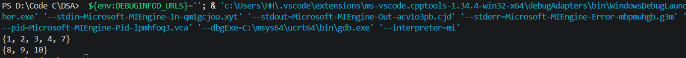
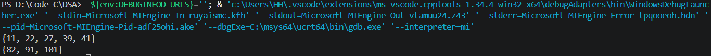

## In-place merge two sorted arrays

Ví dụ có 2 mảng X[m] và Y[n], mình sẽ trộn 2 mảng và sắp xếp lại các phần tử theo thứ tự từ bé đến lớn. Sau đó X nhận m phần tử đầu tiên và Y nhận n phần tử còn lại. 

## Thuật toán

1. Sẽ cần 1 mảng lớn C có kích thước m+n phần tử và lưu các phần tử của 2 mảng X,Y vào mảng C. Sau đó sắp xếp các phần tử trong mảng C theo thứ tự từ bé đến lớn. Cuối cùng tách m phần tử đầu của mảng C thay vào X, n phần tử sau thay vào Y.

2. Thuật toán sắp xếp có thể chọn một trong các thuật toán cơ bản hoặc sắp xếp nâng cao, bài này sử dụng bubbleSort.

## Test case

1. X={ 1, 4, 7, 8, 10 }

   Y= { 2, 3, 9 }
   

2. X[]={ 11, 41, 27, 82, 101 }
   Y[]={ 22, 39, 91 }
   