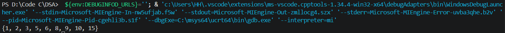
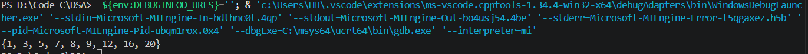

## Merge two arrays by satisfying given constraints

Cho hai mảng đã được sắp xếp X[] và Y[] có kích thước lần lượt là m và n, trong đó m >= n và X[] có chính xác n ô trống(các ô trống sẽ được biểu diễn bằng giá trị 0, do đó các giá trị được sắp xếp đều phải khác 0), hãy hợp nhất các phần tử của Y[] vào đúng vị trí của chúng trong mảng X[], tức là hợp nhất (X, Y) mà vẫn giữ nguyên thứ tự đã sắp xếp.

## Thuật toán

Vì X có chính xác n ô trống và cả 2 đều đã được sắp xếp nên việc cần làm là dồn các phần tử của X lên đầu, các ô trống sẽ ở cuối. Sau đó trộn với mảng Y rồi sắp xếp lại mảng X.

1. Để dồn mảng X lên phía trước thì sẽ dùng 2 số chỉ duyệt từ đầu mảng: 1 cái đi tìm ô trống(i), và 1 cái đi tìm giá trị khác 0(j) sau đó đổi chỗ 2 vị trí. Vì số chỉ của i sẽ tương ứng vừa đúng với số lượng các phần tử khác 0 nên i sẽ chỉ duyệt từ 0 đến m-n-1.

## Test case

1. X[] = { 0, 2, 0, 3, 0, 5, 6, 0, 0 }
   Y[] = { 1, 8, 9, 10, 15 }
   
2. X[]={ 0, 0, 0, 3, 0, 5, 8, 0, 0 };
   Y[]={ 1, 7, 9, 12, 16,20 };
   