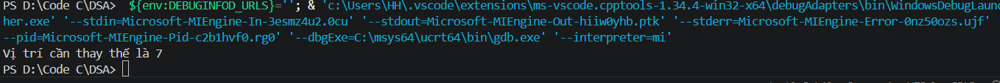
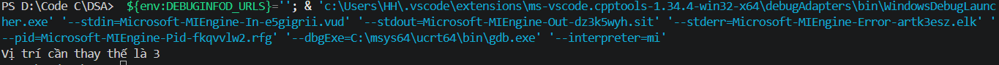

## Find the index of 0 to be replaced to get the maximum length sequence of continuous ones

Cho một mảng nhị phân, hãy tìm chỉ số của phần tử 0 cần được thay thế bằng 1 để thu được chuỗi các phần tử 1 liên tiếp có độ dài tối đa.

## Thuật toán
Mình sẽ cần 1 biến để chứa vị trí của phần tử bằng 0 trước đó, ta sẽ xem giá trị bằng 0 đầu tiên sẽ là A[-1].
B1: Tìm phần tử bằng 0, giả sử thay vị trí này bằng 1 thì chiều dài chuỗi 1 hiện có bằng hiệu 2 index giữa phần tử 0 này và phần tử 0 trước đó
B2: Tìm vị trí phần tử 0 tiếp theo, cộng thêm chiều dài chuỗi 1 giữa 2 phần tử ( tức là với mỗi phần tử 1 thì sum+1)
B3: So sánh sum cuối cùng với sum trước đó, nếu lớn hơn thì lưu lại vị trí tìm được ở B1 và thay giá trị sum để tiếp tục so sánh.
## Test case

1. { 0, 0, 1, 0, 1, 1, 1, 0, 1, 1 }

2. { 0, 0, 1, 0, 1, 1, 1, 0, 0, 1 }
