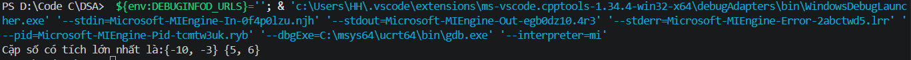
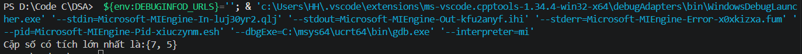

## Find the maximum product of two integers in an array

Cho một dãy số nguyên, hãy tìm tích lớn nhất của hai số nguyên trong dãy đó.

## Thuật toán

1. Viết 1 hàm để tính tích 2 phần tử liên tiếp trong mảng
2. Duyệt qua để tính tích 2 phần tử liên tiếp và so sánh với max, có thể xây dựng 1 mảng index để lưu giá trị các cặp trong trường hợp có nhiều cặp cho cùng kết quả.

## Test case

1. {-10, -3, 5, 6, -2}

2. {-9, -3, 2, 8, -2, 7, 5}
