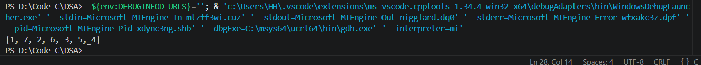
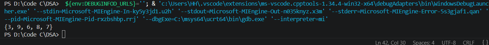
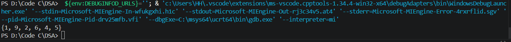

## Rearrange an array with alternate high and low elements

Cho một mảng số nguyên, hãy sắp xếp lại các phần tử trong mảng sao cho mỗi phần tử thứ hai lớn hơn phần tử bên trái và bên phải của nó. Giả sử không có phần tử trùng lặp trong mảng.

## Thuật toán
Do không có các phần tử trùng lặp nên có thể: 
B1: Sắp xêp mảng theo thứ tụ tăng dần
B2: Dùng 2 chỉ số i và j duyệt từ đầu mảng và cuối mảng
B3: Xếp các số theo thứ tự xen kẽ nhau vào mảng mới, tức là A[i], A[j], A[i+1],... (Điều kiện dừng khi j<=i )
## Test case

1. {1, 2, 3, 4, 5, 6, 7}

2. {9, 6, 8, 3, 7} 

3. {6, 9, 2, 5, 1, 4}
