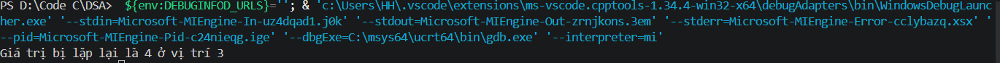
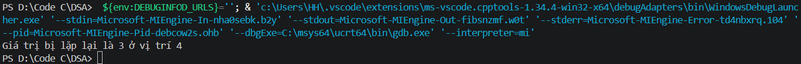

## Find the duplicate element in a limited range array

Cho một mảng có phạm vi giới hạn kích thước n chứa các phần tử từ 1 đến n-1, trong đó có một phần tử lặp lại, hãy tìm số trùng lặp trong mảng mà không sử dụng thêm bất kỳ không gian nào.

## Thuật toán

Cách cơ bản nhất là duyệt mảng 2 lần và trả về giá trị bị lặp lại.

Nhưng nếu mảng được sắp xếp theo thứ tự thì bởi vì mảng có n phần tử ứng với các giá trị từ 1 đến n-1, tức là nếu sắp xếp đúng thì A[0] tương ứng 1, A[1] tương ứng 2, tương tư như vậy A[i] sẽ có giá trị là i+1. Nên ta có thể duyệt 1 lần để xem giá trị đầu tiên nào ứng với index không đúng với quy luật thì sẽ là giá trị bị lặp lại.

Bài này sẽ được trình bày lời giải ứng với trưởng hợp mảng được sắp xếp theo thứ tự.

## Test case

1. A[]= { 1, 2, 4,3, 4 }
    
2. A[]={ 1, 2, 3,3, 4 }
    