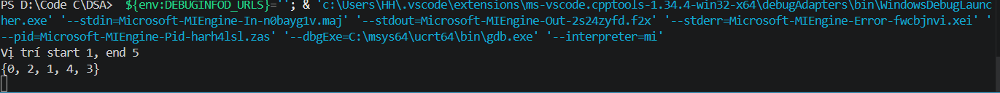
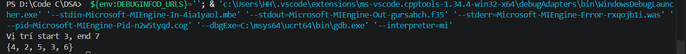
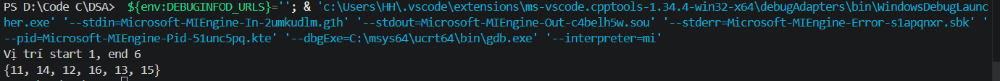

# Problem 6: Find the largest subarray formed by consecutive integers

Tìm mảng con lớn nhất được tạo thành từ các số nguyên liên tiếp 

## Thuật toán:

Vì không yêu cầu các phẩn tử trong mảng con phải liên tiếp nhau mà chỉ cần các số đấy tạo từ các số liên tiếp -> Kích thước mảng con không vượt quá max-min và các phần tử trong mảng chỉ xuất hiện 1 lần duy nhất.

1. Sẽ cần 1 hàm để kiểm tra xem liệu điều kiện các phần tử trong mảng con có thỏa mãn 2 điều kiện trên không:

* Hàm này sẽ được truyền giá trị min max của dãy con đang xét, vì không thay đổi vị trí các phần tử trong mảng nên có thể truyền thêm tham số i,j để lưu vị trí các phần tử đầu và cuối của mảng con:
** Số phần tử không thể vượt quá max-min nên (max-min != j-i)-> return 0.
** Để kiểm tra xem các phần tử trong mảng có xuất hiện 1 lần hay không, sẽ tạo 1 vòng lặp chạy từ i-> j-1: gắn biến x với A[i] rồi so sánh với các phần từ còn lại trong mảng, nếu 1 có 1 trường hợp bằng nhau -> return 0.
** 2 điều kiện trên thỏa mãn thì return 1.

2. Hàm xử lí chính:
** Vì muốn in ra vị trí mảng và các phần tử trong mảng thì sẽ cần 2 biến để lưu vị trí đầu tiên(start) và vị trí cuối cùng(end) của mảng và 1 biến lưu chiều dài mảng (len).
** Vòng lặp để xét các mảng con:
*** i chạy từ 0-> n-2 (n là chiều dài mảng): đặt min1 max1 = A[i], sau đó duyệt vòng lặp j=i+1 đến n-1. Trong vòng lặp này sẽ kiểm tra xem dãy từ i->j có thõa mãn hay ko.Truyền cho min và max giá trị đầu bằng A[i], sau đó min sẽ là giá trị nhỏ hơn giữa min và A[j], tương tự với max rồi truyền vào hàm kiểm tra ở mục 1. Nếu thỏa mãn thì so sánh len với chiều dài mảng mới tìm được -> nếu len bé hơn thì thay len = chiều dài mảng mới và start= i, end=j.
** Với trường hợp mảng có nhiều mảng con với độ dài như nhau( VD: {0,1,2,1,0}) thì sẽ thay vì dùng 2 biến để quản lí start và thì mình sẽ dùng 1 mảng struct gồm start, end để quản lí các mảng con thỏa mãn
### Test case

Các mảng được test chỉ là các mảng cho ra 1 kết quả duy nhất

1. Mảng: { 2, 0, 2, 1, 4, 3, 1, 0 }

2. Mảng: {10, 15, 12, 4, 2, 5, 3, 6, 20, 8}

3. Mảng: {2, 11, 14, 12, 16, 13, 15, 8, 30, 40}

