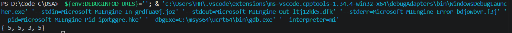
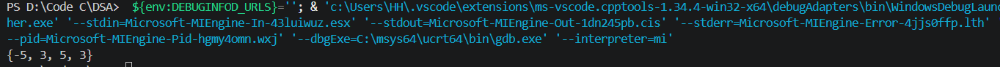

## Find maximum length subarray having a given sum

Tìm mảng con có độ dài lớn nhất có tổng cho trước.

## Thuật toán

Vì yêu cầu tìm mảng lớn nhất có tổng cho trước -> cần 1 hàm để tính tổng các phần tử từ i->j rồi sau đó so sánh với target

1. Dùng vòng lặp để tính tổng các phần tử từ i-> j, mình sẽ xét i đi từ 0->n-1 và j đi từ i+1 -> n
2. Trong main sẽ có 1 hàm lưu start, end của mảng con thỏa mãn điều kiện. So sánh len có sẵn với chiều dài mảng mới tìm được. Nếu chiều dài mảng mới lớn hơn thì thay vị trí start và end cho mảng con.

### Test case

1. Mảng: { 5, 6, -5, 5, 3, 5, 3, -2, 0 }, target: 8

2. Mảng: { 5, 6, -5, 3, 5, 3, -2, 0 }, target: 6

