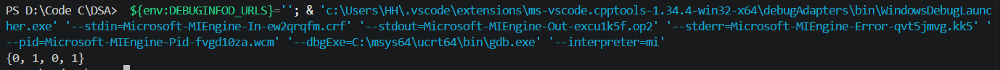
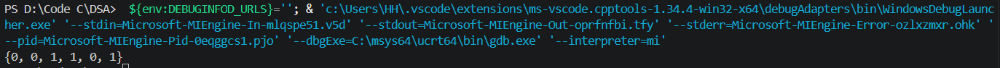

## Find the largest subarray having an equal number of 0’s and 1’s

Tìm mảng lớn nhất chứa số lượng phần tử 0 và 1 bằng nhau

## Thuật toán

1. Xây dựng 1 hàm để kiểm tra xem mảng con có thỏa mãn điều kiện số lượng phần tử 0 và 1 có bằng nhau không.

2. Sẽ cần quản lí vị trí của mảng con tìm được (start và end), thêm 1 biến để so sánh chiều dài (len). Vì có thể có nhiều mảng con thỏa mãn nên có thể xây dựng 1 mảng struct gồm start và end. Mảng struct sẽ được quản lí bằng 1 biến đếm để quản lí số lượng phần tử trong mảng nhưng trong bài này sẽ chỉ trình bày giải thuật để in ra mảng con đầu tiên tìm được.

## Test case

1. Mảng: { 0, 0, 1, 0, 1, 0, 0 }

2. Mảng: { 0,0, 1, 1, 0, 1, 0, 0 }

