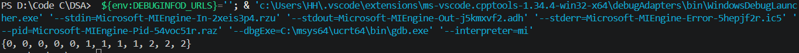
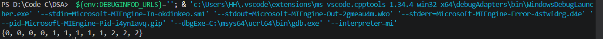

# Sort an array of 0’s, 1’s, and 2’s (Dutch National Flag Problem)

Given an array containing only 0’s, 1’s, and 2’s, sort it in linear time and using constant space.

## Thuật toán

Vì để thuật toán chạy trong thời gian tuyến tính hay độ phức tạp là O(n) thì ta chỉ được phép duyệt mảng một lần duy nhất. Do đó cần xây dựng 1 thuật toán sắp xếp chỉ trong 1 lần duyệt.

Tại vì chỉ có 3 giá trị 0,1,2 thì mình sẽ chọn pivot = 1. Khi duyệt mảng những giá trị lớn hơn pivot sẽ được đẩy xuống cuối, giá trị nhỏ hơn pivot thì đẩy lên đầu mảng và giá trị bằng pivot sẽ giữ nguyên vị trí. Do đó cần biến quản lí đầu mảng(start), cuối mảng(end) và thêm 1 biến (index) để duyệt qua các phần tử. Khi giá trị 2 bị đổi xuống cuối mảng thì phải kiểm tra tiếp xem giá trị được đổi lên là bao nhiêu, nhưng khi đổi giá trị 0 lên đầu mảng thì không cần kiểm tra lại( giá trị mới chỉ có thể bằng pivot). Vòng lặp sẽ dừng khi index>end, tức lúc này index đang dừng ở giá trị đầu tiên của dãy các phần tử có giá trị bằng 2.

### Test case 

1. Mảng: { 0, 1, 2, 2, 1, 0, 0, 2, 0, 1, 1, 0 }

2. Mảng: { 2, 1, 2, 1, 1, 0, 0, 2, 0, 1, 1, 0 }

